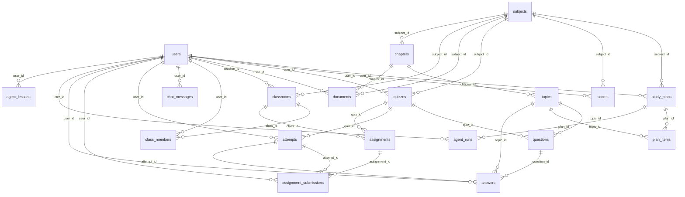

# Lược đồ cơ sở dữ liệu — AI Learning Assistant

Trích từ hệ thống đang chạy (22/09/2026): **19 bảng, 126 cột, 34 khoá ngoại, 439 dòng**; ChromaDB **1,321 vector × 768 chiều**.

## 1. Sơ đồ ERD

## 2. ChromaDB (vector store)

- Collection `chunks`, cosine; embedding `gemini-embedding-001` 768 chiều; hybrid BM25 + vector (RRF).
- id = `{doc_id}-{page}-{i}`; metadata: `doc_id`, `page`, `user_id`, `subject_id`, `chapter_id`, `filename`; lưu tại `data/chroma/`.

## Người dùng & phân quyền

### `users` — 13 dòng

Tài khoản. Vai trò user / teacher / admin. Mật khẩu và mã khôi phục lưu dạng băm bcrypt, không lưu bản gốc.

| Cột | Kiểu | Khoá | Ý nghĩa |
|---|---|---|---|
| `id` | int | PK |  |
| `username` | text |  |  |
| `goal` | text |  | mục tiêu học |
| `created_at` | datetime |  |  |
| `password_hash` | text |  | bcrypt |
| `role` | text |  | user / teacher / admin |
| `email` | text |  | tuỳ chọn |
| `recovery_hash` | text |  | bcrypt của mã khôi phục |
| `reset_fails` | int |  | số lần nhập sai mã liên tiếp |
| `reset_locked_until` | datetime |  | khoá quên-mật-khẩu tới lúc |

## Kiến thức (taxonomy)

### `subjects` — 3 dòng

Môn học (Toán 12, Vật lí 12, Hoá học 12).

| Cột | Kiểu | Khoá | Ý nghĩa |
|---|---|---|---|
| `id` | int | PK |  |
| `name` | text |  |  |

### `chapters` — 18 dòng

Chương của môn, có thứ tự.

| Cột | Kiểu | Khoá | Ý nghĩa |
|---|---|---|---|
| `id` | int | PK |  |
| `subject_id` | int | FK → subjects.id |  |
| `name` | text |  |  |
| `order` | int |  | thứ tự trong môn |

### `topics` — 63 dòng

Chủ đề — đơn vị phân tích nhỏ nhất. Mọi câu hỏi, câu trả lời, đoạn tài liệu, việc trong lộ trình đều gắn topic_id.

| Cột | Kiểu | Khoá | Ý nghĩa |
|---|---|---|---|
| `id` | int | PK |  |
| `chapter_id` | int | FK → chapters.id |  |
| `name` | text |  | tên chủ đề |

## Tài liệu (RAG)

### `documents` — 21 dòng

Tài liệu đã nạp (SGK theo chương). Nội dung đoạn văn nằm ở ChromaDB; bảng này chỉ giữ metadata và trạng thái.

| Cột | Kiểu | Khoá | Ý nghĩa |
|---|---|---|---|
| `id` | int | PK |  |
| `user_id` | int | FK → users.id |  |
| `subject_id` | int | FK → subjects.id |  |
| `chapter_id` | int | FK → chapters.id |  |
| `filename` | text |  |  |
| `path` | text |  | đường dẫn file trên máy chủ |
| `n_chunks` | int |  | số đoạn đã index vào Chroma |
| `status` | text |  | pending / ready / failed |
| `error` | text |  | lỗi OCR/embedding nếu có |
| `created_at` | datetime |  |  |

## Học tập & đánh giá

### `scores` — 4 dòng

Điểm nhập tay (miệng, 15 phút, giữa kỳ, cuối kỳ) có hệ số.

| Cột | Kiểu | Khoá | Ý nghĩa |
|---|---|---|---|
| `id` | int | PK |  |
| `user_id` | int | FK → users.id |  |
| `subject_id` | int | FK → subjects.id |  |
| `kind` | text |  | mieng / 15p / giua_ky / cuoi_ky |
| `value` | float |  |  |
| `weight` | float |  | hệ số 1–3 |
| `date` | datetime |  |  |

### `quizzes` — 15 dòng

Một đề trắc nghiệm do AI sinh (hoặc đề mẫu của giáo viên).

| Cột | Kiểu | Khoá | Ý nghĩa |
|---|---|---|---|
| `id` | int | PK |  |
| `user_id` | int | FK → users.id |  |
| `subject_id` | int | FK → subjects.id |  |
| `difficulty` | text |  | easy / medium / hard |
| `created_at` | datetime |  |  |

### `questions` — 75 dòng

Câu hỏi trong đề: 4 lựa chọn (JSON), chỉ số đáp án đúng, giải thích, cờ 🚩 báo sai.

| Cột | Kiểu | Khoá | Ý nghĩa |
|---|---|---|---|
| `id` | int | PK |  |
| `quiz_id` | int | FK → quizzes.id |  |
| `topic_id` | int | FK → topics.id |  |
| `difficulty` | text |  |  |
| `content` | text |  |  |
| `options` | json |  | JSON 4 lựa chọn |
| `correct` | int |  | chỉ số 0–3 của đáp án đúng |
| `explanation` | text |  | lời giải AI |
| `flagged` | bool |  | người dùng báo câu sai (🚩) |

### `attempts` — 13 dòng

Một lần làm bài của một người dùng.

| Cột | Kiểu | Khoá | Ý nghĩa |
|---|---|---|---|
| `id` | int | PK |  |
| `quiz_id` | int | FK → quizzes.id |  |
| `user_id` | int | FK → users.id |  |
| `score` | float |  | điểm /10 |
| `submitted_at` | datetime |  |  |

### `answers` — 65 dòng

Kết quả TỪNG CÂU, gắn topic — bảng quan trọng nhất: nguồn cho mastery, spaced repetition, DKT, phản tư.

| Cột | Kiểu | Khoá | Ý nghĩa |
|---|---|---|---|
| `id` | int | PK |  |
| `attempt_id` | int | FK → attempts.id |  |
| `question_id` | int | FK → questions.id |  |
| `user_id` | int | FK → users.id |  |
| `topic_id` | int | FK → topics.id |  |
| `difficulty` | text |  | sao chép từ câu hỏi để phân tích nhanh |
| `selected` | int |  | lựa chọn đã chọn (null = bỏ trống) |
| `is_correct` | bool |  | đúng/sai |
| `answered_at` | datetime |  | thời điểm — dùng cho suy giảm theo thời gian & DKT |

## Hỏi đáp

### `chat_messages` — 18 dòng

Lịch sử hỏi đáp RAG; câu trả lời kèm trích dẫn (JSON: file, trang, đoạn).

| Cột | Kiểu | Khoá | Ý nghĩa |
|---|---|---|---|
| `id` | int | PK |  |
| `user_id` | int | FK → users.id |  |
| `role` | text |  | user / assistant |
| `content` | text |  |  |
| `citations` | json |  | JSON trích dẫn |
| `created_at` | datetime |  |  |

## Lộ trình học

### `study_plans` — 11 dòng

Lộ trình do AI/agent tạo. snapshot = mastery từng chủ đề lúc tạo, để sau này đo hiệu quả.

| Cột | Kiểu | Khoá | Ý nghĩa |
|---|---|---|---|
| `id` | int | PK |  |
| `user_id` | int | FK → users.id |  |
| `subject_id` | int | FK → subjects.id |  |
| `goal` | text |  |  |
| `days` | int |  | số ngày |
| `summary` | text |  | nhận xét của AI (markdown) |
| `evidence` | text |  | số liệu lúc tạo (text cho AI) |
| `created_at` | datetime |  |  |
| `snapshot` | json |  | JSON {topic_id: mastery%} lúc tạo |

### `plan_items` — 107 dòng

Việc trong lộ trình theo ngày (study / quiz / review), tick hoàn thành.

| Cột | Kiểu | Khoá | Ý nghĩa |
|---|---|---|---|
| `id` | int | PK |  |
| `plan_id` | int | FK → study_plans.id |  |
| `day` | int |  |  |
| `topic_id` | int | FK → topics.id |  |
| `kind` | text |  | study / quiz / review |
| `title` | text |  |  |
| `detail` | text |  |  |
| `done` | bool |  | đã hoàn thành |

## Lớp học (giáo viên)

### `classrooms` — 1 dòng

Lớp do giáo viên tạo; code = mã tham gia.

| Cột | Kiểu | Khoá | Ý nghĩa |
|---|---|---|---|
| `id` | int | PK |  |
| `name` | text |  |  |
| `code` | text |  | mã tham gia, ví dụ LOPT-11F2 |
| `teacher_id` | int | FK → users.id | giáo viên tạo lớp |
| `subject_id` | int | FK → subjects.id |  |
| `created_at` | datetime |  |  |

### `class_members` — 4 dòng

Học sinh thuộc lớp.

| Cột | Kiểu | Khoá | Ý nghĩa |
|---|---|---|---|
| `id` | int | PK |  |
| `class_id` | int | FK → classrooms.id |  |
| `user_id` | int | FK → users.id |  |
| `joined_at` | datetime |  |  |

### `assignments` — 0 dòng

Đề giáo viên giao cho lớp (tham chiếu đề mẫu quiz_id).

| Cột | Kiểu | Khoá | Ý nghĩa |
|---|---|---|---|
| `id` | int | PK |  |
| `class_id` | int | FK → classrooms.id |  |
| `quiz_id` | int | FK → quizzes.id | đề mẫu; mỗi học sinh làm sẽ được sao chép thành quiz riêng |
| `title` | text |  |  |
| `due` | datetime |  | hạn nộp |
| `created_at` | datetime |  |  |

### `assignment_submissions` — 0 dòng

Bài nộp của học sinh cho đề được giao.

| Cột | Kiểu | Khoá | Ý nghĩa |
|---|---|---|---|
| `id` | int | PK |  |
| `assignment_id` | int | FK → assignments.id |  |
| `user_id` | int | FK → users.id |  |
| `attempt_id` | int | FK → attempts.id |  |
| `score` | float |  |  |
| `submitted_at` | datetime |  |  |

## Agent tự đánh giá

### `agent_runs` — 6 dòng

Nhật ký mỗi lần agent chạy: chế độ, số tool, điểm phản biện, vi phạm validator, thời gian.

| Cột | Kiểu | Khoá | Ý nghĩa |
|---|---|---|---|
| `id` | int | PK |  |
| `user_id` | int | FK → users.id |  |
| `mode` | text |  | quick / agent / multi |
| `plan_id` | int | FK → study_plans.id |  |
| `n_tool_calls` | int |  |  |
| `critic_score` | int |  | điểm agent phản biện 0–10 |
| `critic_approved` | bool |  |  |
| `violations` | json |  | JSON vi phạm 5 luật |
| `duration_s` | float |  |  |
| `created_at` | datetime |  |  |

### `agent_lessons` — 2 dòng

Bài học agent tự rút ra từ hậu quả kế hoạch; active = đang được chèn vào prompt.

| Cột | Kiểu | Khoá | Ý nghĩa |
|---|---|---|---|
| `id` | int | PK |  |
| `user_id` | int | FK → users.id | null = bài học chung |
| `lesson` | text |  |  |
| `evidence` | text |  |  |
| `source_plan_id` | int |  |  |
| `active` | bool |  | đang áp dụng |
| `created_at` | datetime |  |  |

## Kết nối — code ở đâu

| | Tên | Loại | Vị trí | Code kết nối |
|---|---|---|---|---|
| CSDL quan hệ | app.db | SQLite 3.46 (SQLAlchemy 2.0) | data/app.db | app/db.py dòng 11–12: create_engine("sqlite:///data/app.db") |
| CSDL vector | collection chunks | ChromaDB 1.5.9 | data/chroma/ | app/rag/ingest.py dòng 11–16: PersistentClient + get_or_create_collection("chunks", cosine) |

Đường dẫn cấu hình tại app/config.py (DB_PATH, CHROMA_DIR). Tạo bảng + migration tự động: init_db() trong app/db.py.

Mẫu dùng trong mọi module: with SessionLocal() as s: s.query(...) / s.add(...); s.commit(). Không viết SQL tay.

Xem trực tiếp: sqlite3 data/app.db ".tables"  hoặc DB Browser for SQLite mở data/app.db.
Đổi sang PostgreSQL: sửa 1 dòng create_engine; Chroma -> pgvector: sửa app/rag/ingest.py.
